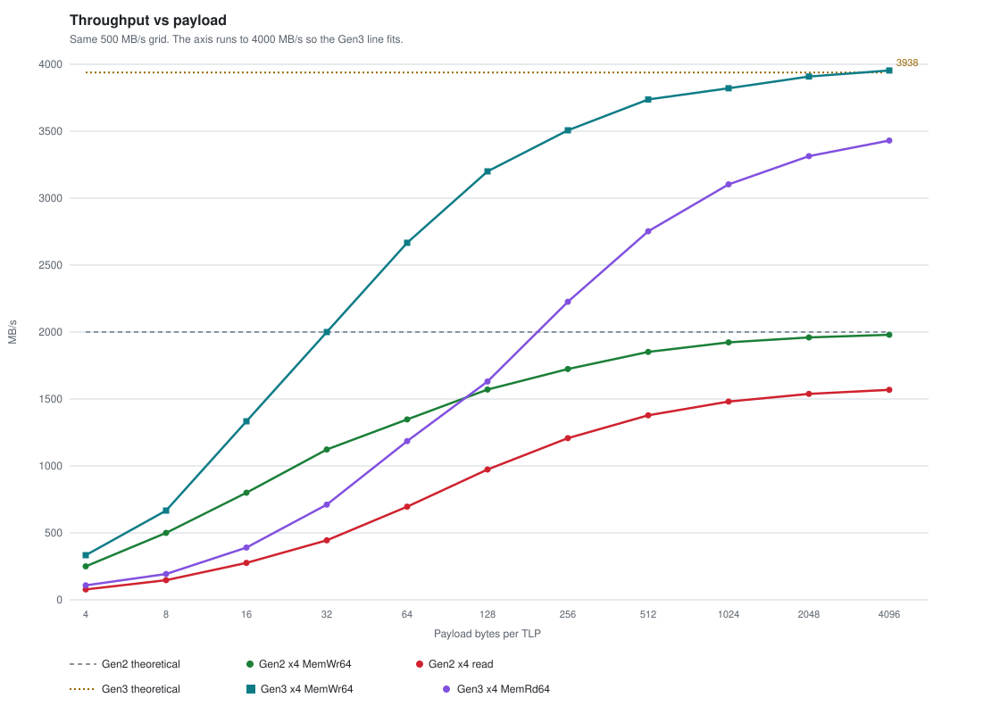

# Rivet

**Rivet** is an open PCIe soft IP: a multi-mode **controller** plus family **PHY** wrappers, delivered as a full **`rivet_pcie`** soft IP for FPGA (ASIC later, backlog).

## Status

| Area | State |
|------|--------|
| Mode | Gen2 EP, RC, USP, and DSP closed in sim |
| Generation | **Gen4 EP x4 closed in simulation.** Gen5 is not started ([evolution notes](docs/gen-evolution.md)) |
| Lanes | Parametric ×1 / ×2 / ×4 |
| Target FPGA | **VMK180** preferred, **VCU118** also in tree. VPK180 is the later Premium path |
| Verification | Phase 1 MVP + Phase 2 Full Gen2 EP (sim) closed; Verilator CI; Vivado BFM side-path |

Phase 1/2 Gen2 EP sim gates, Phase 3 Gen2 port roles, Phase 4 Gen3 EP x4, and Phase 5 Gen4 EP x4 are closed (see [roadmap](docs/roadmap.md), [verification](docs/verification.md)). Next: Gen5 backlog, not started.

## Measured throughput

Gen2, Gen3, and Gen4 x4, eight TLPs per size, 4 ns user clock. The full table is in [perf-poster.md](docs/perf-poster.md).



Gen4 x4 on 25 Nov 2026 (`UVM_ERROR : 0`, `UVM_FATAL : 0`): MemWr64 printed 888.889 MB/s at 4 bytes, 4923.077 MB/s at 32 bytes, 6095.238 MB/s at 64 bytes, and 7961.127 MB/s at 4096 bytes. MemRd64 printed 7447.273 MB/s at 4096 bytes.

## Repository layout

```text
rtl/pcie_ctrl/        Soft controller top + rivet_pkg (to PIPE)
  mac/ dll/ tl/       Layer sources (LTSSM/OS, DLLP/FC, TLP/cfg)
rtl/phy/              PG239 / PG345 family PHY wrappers
rtl/top/              rivet_pcie = ctrl + phy
rtl/interfaces/       PIPE, AXI-ST, cfg_mgmt SV interfaces
tb/uvm/               Primary UVM (DUT = rivet_pcie_ctrl)
tb/bfm/               Vivado BFM side-path (PG239 PHY example first)
```

## Target hardware

The lab ask is a **VMK180** first. A **VCU118** still covers the UltraScale+ shell that is already in the tree.

| Kit | FPGA | Notes |
|-----|------|-------|
| **AMD Versal Prime VMK180** | **XCVM1802** | Preferred. PG345 GTY, Gen2 ×4 on quad 103 (`fpga/vmk180`) |
| **AMD Virtex UltraScale+ VCU118** | **XCVU9P** | Also in tree. PG239 GTY (`fpga/vcu118`) |
| **AMD Versal Premium VPK180** | Versal Premium | Later GTYP / Gen5 path. Not a bring-up request |

Sim / RTL default today still exercises the UltraScale+ (`FPGA_FAMILY=0` → `rivet_pcie_phy_usplus`) path. Versal is `FPGA_FAMILY=2` → `rivet_pcie_phy_versal`.

## License

Apache License 2.0 — see [LICENSE](LICENSE).

Specifications are not redistributed; obtain PCIe / PIPE / PG213 / PG239 yourself.

## Support / sponsors / hardware

Early-stage open interconnect IP. **Hardware sponsorship is a real blocker** for FPGA bring-up.

A loan or a donation of one of these kits unblocks the lab. The **VMK180** is the kit we want first.

- **AMD Versal Prime VMK180** (**XCVM1802**, EK-VMK180-G) — preferred. PG345 GTY, Gen2 ×4, project `fpga/vmk180`
- **AMD Virtex UltraScale+ VCU118** (**XCVU9P**, EK-U1-VCU118-G) — second choice. PG239 GTY, project `fpga/vcu118`

Also welcome:

- Sponsorship for simulation tooling (Questa) and related costs
- Review of UVM methodology and PIPE / AXI-ST fidelity
- Other AMD/Xilinx PCIe evaluation boards with a usable edge connector

If you can ship a board, fund a kit, or connect us to AMD/Xilinx university / open-source hardware programs — please open an issue or reach out. Thank you.
