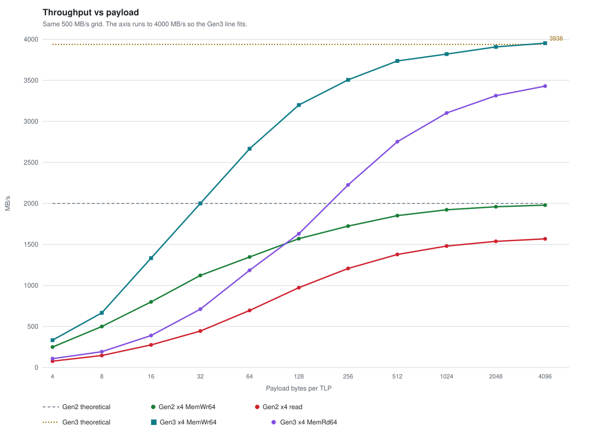

# Rivet x4 — measured results

Endpoint `rivet_pcie_ctrl` at PIPE, 4 lanes. The chart below is the plotted set: Gen2, Gen3, and Gen4. Each `mb_s` in that chart was printed by a sweep that finished with no UVM error. The tables under it are the same points, then the earlier Gen2 runs that are not those curves. `user_clk` on the payload sweeps is 4.0 ns. The read-latency, inbound, and credit-stall rows still print `user_clk_ns=8.0`.

| Line | Rate |
|---|---|
| Gen2 x4 symbol data after 8b/10b | 2000 MB/s |
| Gen3 x4, 8 GT/s, 128b/130b | 3938 MB/s |
| Gen4 x4, 16 GT/s, 128b/130b | 7877 MB/s |

A full beat every 4 ns user clock is 2000 MB/s on the Gen2 64-bit port and 4000 MB/s on the Gen3/Gen4 128-bit port. The Gen4 line rate sits above that user-port ceiling. Payload sizes are 4, 8, 16, 32, 64, 128, 256, 512, 1024, 2048, and 4096 bytes.

## Plotted sweeps

Eight TLPs per size. Blank Gen4 cells were not printed: from 512 bytes up, RQ `tready` stayed low, so that curve stops at 256 bytes. The Gen4 MemRd64 sweep printed unmatched RC tags and is not a measured series.

| Bytes | Gen2 MemWr64 | Gen2 read | Gen3 MemWr64 | Gen3 MemRd64 | Gen4 MemWr64 |
|---:|---:|---:|---:|---:|---:|
| 4 | 250.000 | 79.208 | 333.333 | 108.108 | 333.333 |
| 8 | 500.000 | 146.789 | 666.667 | 192.771 | 666.667 |
| 16 | 800.000 | 285.714 | 1333.333 | 390.244 | 1333.333 |
| 32 | 1142.857 | 450.704 | 2000.000 | 711.111 | 2000.000 |
| 64 | 1438.202 | 723.164 | 2666.667 | 1185.185 | 2666.667 |
| 128 | 1651.613 | 1019.920 | 3200.000 | 1630.573 | 3200.000 |
| 256 | 1790.210 | 1292.929 | 3506.849 | 2226.087 | 3555.556 |
| 512 | 1889.299 | 1497.076 | 3737.226 | 2752.688 | |
| 1024 | 1943.074 | 1625.397 | 3820.896 | 3103.030 | |
| 2048 | 1970.178 | 1698.176 | 3908.397 | 3313.916 | |
| 4096 | 1983.055 | 1737.065 | 3953.668 | 3430.486 | |

Gen4 MemWr64 (`perf_rq_memwr64_gen4_x4`, 25 Nov 2026, 8 TLPs after Gen4 L0) also printed the cycle counts. `rq_stall=0` and `credit_stall=0`. `UVM_ERROR : 0`, `UVM_FATAL : 0`.

| Payload | Bytes / TLP | Bytes, 8 TLPs | user cycles | MB/s |
|---:|---:|---:|---:|---:|
| 1 DW | 4 | 32 | 24 | 333.333 |
| 2 DW | 8 | 64 | 24 | 666.667 |
| 4 DW | 16 | 128 | 24 | 1333.333 |
| 8 DW | 32 | 256 | 32 | 2000.000 |
| 16 DW | 64 | 512 | 48 | 2666.667 |
| 32 DW | 128 | 1024 | 80 | 3200.000 |
| 64 DW | 256 | 2048 | 144 | 3555.556 |

## Gen2 posted write, 22 Nov 2026

`perf_rq_sweep_gen2_x4`, 8 MemWr32 TLPs per size, 0 UVM errors. This is not the green MemWr64 curve above. Each size waits 8000 `pclk` cycles so the previous burst's replay is finished. `mb_s` is payload bytes on the 4 ns user bus (`bytes * 250 / cycles`). Every size printed `credit_stall=0` and `tfc_nph_min=15`.

| Payload | Bytes / TLP | Bytes, 8 TLPs | user cycles | RQ stalls | MB/s | % of 2000 MB/s |
|---:|---:|---:|---:|---:|---:|---:|
| 1 DW | 4 | 32 | 32 | 0 | 250.000 | 12.500 |
| 2 DW | 8 | 64 | 32 | 0 | 500.000 | 25.000 |
| 4 DW | 16 | 128 | 40 | 0 | 800.000 | 40.000 |
| 8 DW | 32 | 256 | 57 | 1 | 1122.807 | 56.140 |
| 16 DW | 64 | 512 | 96 | 8 | 1333.333 | 66.667 |
| 32 DW | 128 | 1024 | 163 | 11 | 1570.552 | 78.528 |
| 64 DW | 256 | 2048 | 297 | 17 | 1723.906 | 86.195 |
| 128 DW | 512 | 4096 | 553 | 17 | 1851.718 | 92.586 |
| 256 DW | 1024 | 8192 | 1065 | 17 | 1923.005 | 96.150 |
| 512 DW | 2048 | 16384 | 2090 | 18 | 1959.809 | 97.990 |
| 1024 DW | 4096 | 32768 | 4138 | 18 | 1979.700 | 98.985 |

1024 DW is 4096 bytes on each TLP. The wire length field is 0 for that size. The "Bytes, 8 TLPs" column is the `bytes=` field from the PERF line.

`perf_rq_memwr64_gen2_x4` on that same bench is MemWr64 (`addr[63:32]=1`, TLP type 0x60). UVM reported 0 errors. Ten sizes printed the same cycles, stalls, and `mb_s` as the MemWr32 table. The 64-byte point printed `cycles=95`, `rq_stall=7`, `mb_s=1347.368`, `pct_gen2x4=67.368`. The 4096-byte point is again 1979.700 MB/s. The plotted Gen2 MemWr64 column above is a later printed curve and ends at 1983.055 MB/s.

An earlier 16× 1DW run with a finite-credit peer and a one-cycle bubble between beats printed 83.333 MB/s. That number is not either posted-write curve.

## Gen3 posted write, 24 Nov 2026

`perf_rq_sweep_gen3_x4`, 8 MemWr32 TLPs after L0 at 8 GT/s, 0 UVM errors. `pct_gen2x4` is still the fraction of 2000 MB/s, not of the 3938 MB/s Gen3 line. This MemWr32 sweep is not the teal MemWr64 curve.

| Payload | Bytes / TLP | Bytes, 8 TLPs | user cycles | RQ stalls | MB/s | % of 2000 MB/s |
|---:|---:|---:|---:|---:|---:|---:|
| 1 DW | 4 | 32 | 32 | 0 | 250.000 | 12.500 |
| 2 DW | 8 | 64 | 32 | 0 | 500.000 | 25.000 |
| 4 DW | 16 | 128 | 40 | 0 | 800.000 | 40.000 |
| 8 DW | 32 | 256 | 59 | 3 | 1084.746 | 54.237 |
| 16 DW | 64 | 512 | 100 | 12 | 1280.000 | 64.000 |
| 32 DW | 128 | 1024 | 172 | 20 | 1488.372 | 74.419 |
| 64 DW | 256 | 2048 | 310 | 30 | 1651.613 | 82.581 |
| 128 DW | 512 | 4096 | 564 | 28 | 1815.603 | 90.780 |
| 256 DW | 1024 | 8192 | 1080 | 32 | 1896.296 | 94.815 |
| 512 DW | 2048 | 16384 | 2108 | 36 | 1943.074 | 97.154 |
| 1024 DW | 4096 | 32768 | 4164 | 44 | 1967.339 | 98.367 |

## Gen2 requester read, 23 Nov 2026

`perf_rq_memrd_gen2_x4` sends eight MemRd32 at each size, then the same sizes as MemRd64. The byte count is CplD payload on RC. The peer returns one completion per request and advertises infinite credits. UVM reported 0 errors and 0 fatals. MemRd64 printed the same `cycles`, `mb_s`, and latency as MemRd32 at every size. Every size printed `rq_stall=0`, `credit_stall=0`, `tfc_zero=0`, and `tfc_nph_min=15`. This table is not the red Gen2 read curve on the chart. That curve ends at 1737.065 MB/s.

| Payload | Bytes / TLP | Bytes, 8 TLPs | user cycles | MB/s | % of 2000 MB/s | lat min / avg / max |
|---:|---:|---:|---:|---:|---:|---:|
| 1 DW | 4 | 32 | 103 | 77.670 | 3.883 | 51 / 61 / 71 |
| 2 DW | 8 | 64 | 109 | 146.789 | 7.339 | 54 / 66 / 77 |
| 4 DW | 16 | 128 | 116 | 275.862 | 13.793 | 56 / 70 / 84 |
| 8 DW | 32 | 256 | 144 | 444.444 | 22.222 | 63 / 87 / 112 |
| 16 DW | 64 | 512 | 184 | 695.652 | 34.783 | 75 / 113 / 152 |
| 32 DW | 128 | 1024 | 263 | 973.384 | 48.669 | 98 / 164 / 231 |
| 64 DW | 256 | 2048 | 424 | 1207.547 | 60.377 | 147 / 269 / 392 |
| 128 DW | 512 | 4096 | 743 | 1378.197 | 68.910 | 242 / 476 / 711 |
| 256 DW | 1024 | 8192 | 1383 | 1480.839 | 74.042 | 434 / 892 / 1351 |
| 512 DW | 2048 | 16384 | 2663 | 1538.115 | 76.906 | 818 / 1724 / 2631 |
| 1024 DW | 4096 | 32768 | 5223 | 1568.447 | 78.422 | 1586 / 3388 / 5191 |

1024 DW is 4096 bytes on each completion. The window closes when `rc_tlast` reaches 8, so the drain between sizes is not inside the cycle count. At 4096 bytes, `lat_max - lat_min` is 3605 cycles across the seven gaps after the first completion, 515 cycles each. The printed 1568.447 MB/s still includes that first round trip (`lat_min=1586`).

## Other Gen2 prints

| Test | Printed result |
|---|---|
| Read latency, 8× RQ MemRd → RC CplD | min 363, avg 458, max 714 `user_clk` cycles on the 8.0 ns bench. Includes the PIPE peer. Not re-run at 4 ns |
| Inbound, 8× CQ MemRd → CC CplD | 8 CQ packets and 8 CC completions, 32 payload bytes in 2876 `user_clk` cycles. **1.391 MB/s** at `user_clk_ns=8.0`. The window includes the wait for each peer MemRd |
| Credit stall, 12× RQ MemRd | 0 RQ stall cycles, 0 cycles with `pcie_tfc_nph_av = 0`. Lowest NPH credit scale observed: 4. Measured at `user_clk_ns=8.0` |

Routed timing below is the streaming-TX image from 22 Nov 2026, before the completion-path RAM. Those logs are not the current netlist. The figures are the run properties after place and route, not a data rate.

| Board | WNS | TNS | WHS | Image |
|---|---:|---:|---:|---|
| VCU118 | +0.029814 ns | 0 | +0.011372 ns | bitstream, progress 100% |
| VMK180 | +0.052571 ns | 0 | +0.025194 ns | PDI, progress 100%, DRC 0 errors |
